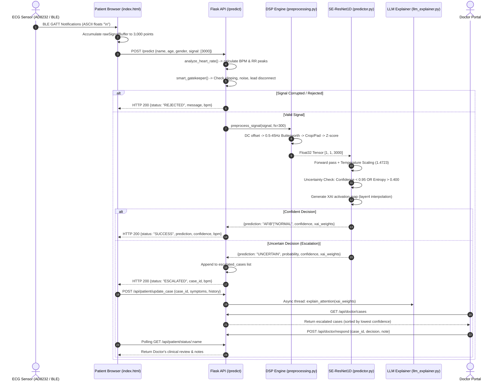

# SCAI CardioSense - Architecture & System Analysis Guide

## Overview & Context
This document is a comprehensive technical analysis of the **CardioSense** project for .NET (C#) engineers. CardioSense is a clinical AI triage and real-time ECG monitoring platform designed to ingest 10-second single-lead ECG recordings (3,000 samples at 300 Hz) from wearable Bluetooth sensors, run biomedical signal processing, detect arrhythmias (specifically Atrial Fibrillation - AFib), quantify uncertainty via Shannon Entropy and Temperature Scaling, and escalate ambiguous cases to a physician review portal with Explainable AI (XAI) heatmaps and clinical LLM interpretation notes.

---

## Architecture Diagram

```mermaid
graph TB
    subgraph ClientLayer ["Client Layer (Browser / SPA: templates/index.html)"]
        BLE["Web Bluetooth API (AD8232 / Sensor)"]
        PV["Patient Portal View"]
        DV["Doctor Portal View"]
        AV["Admin Telemetry View"]
    end

    subgraph ServerLayer ["Backend Host (Flask / Gunicorn: app.py)"]
        Gatekeeper["smart_gatekeeper() & analyze_heart_rate()"]
        DSP["preprocess_signal() (preprocessing.py)"]
        Inference["predict() (predictor.py)"]
        CNN["Medical_ECG_Net (PyTorch CPU)"]
        XAI["XAI Activation Interpolator"]
        LLM["explain_attention() (llm_explainer.py)"]
        MemState["In-Memory State (escalated_cases, patient_decisions, ml_dataset)"]
        DiskStore[("JSON Flat-Files (patient_history.json, consent_log.json)")]
    end

    BLE -->|GATT Notifications 300Hz| PV
    PV -->|POST /predict (3000 samples)| Gatekeeper
    Gatekeeper -->|Valid Signal| DSP
    DSP -->|Tensor 1x1x3000| Inference
    Inference --> CNN
    CNN --> XAI
    Inference -->|Low Confidence / High Entropy| MemState
    PV -->|POST /api/patient/update_case| MemState
    MemState -.->|Background Thread| LLM
    DV -->|GET /api/doctor/cases| MemState
    DV -->|POST /api/doctor/respond| MemState
    PV -->|Poll GET /api/patient/status/:name| MemState
    AV -->|GET /api/admin/stats & export_dataset| MemState
    MemState --> DiskStore
```

---

## 1. Project Summary
* **Purpose:** Real-time ECG monitoring and arrhythmia (AFib) screening/triage web platform connecting patients and cardiologists.
* **User Roles:**
  * **Patient:** Captures live ECG signals via Web Bluetooth, views BPM and immediate AI triage status, inputs medical complaints and chronic history upon case escalation, downloads clinical PDF reports, and receives physician review feedback.
  * **Doctor:** Monitors an escalation queue sorted by AI uncertainty, reviews 10-second raw waveforms overlaid with XAI attention maps via Chart.js, reads AI clinical attention notes, reviews patient history, and submits final verdicts (`INFECTED`/AFib, `HEALTHY`/Normal, `NOISY`/Artifact) with clinical notes.
  * **Admin:** Monitors real-time triage statistics (total, rejected, escalated, normal, AFib) and exports the accumulated human-in-the-loop active learning dataset as a raw CSV (`scai_clinical_dataset.csv`).
* **Main Flows:**
  1. *Autonomous Screening Flow:* Patient captures 3,000 samples -> POST `/predict` -> Gatekeeper validates signal quality -> CNN evaluates rhythm -> If confident (>= 95% and entropy <= 0.400), an instant result (`NORMAL` or `AFIB`) is returned to the patient.
  2. *Human-in-the-Loop Escalation Flow:* If the CNN yields confidence < 95% or entropy > 0.400, the case is tagged `UNCERTAIN` -> Escalated to doctor queue -> Patient submits symptoms via POST `/api/patient/update_case` -> Background worker generates an LLM interpretation note -> Doctor reviews waveform and submits verdict via POST `/api/doctor/respond` -> Patient polls `/api/patient/status/<name>` and receives the final physician decision.
  3. *Continuous Learning Export Flow:* Every physician adjudication pairs the raw 3,000-sample signal with the model's raw inference and doctor's ground-truth label in `ml_dataset` -> Admin exports this data via GET `/api/admin/export_dataset`.

---

## 2. Tech Stack (.NET C# Mapping)

| Technology / Library | Purpose in this Project | .NET (C#) Equivalent & Conceptual Mapping |
| :--- | :--- | :--- |
| **Python 3.10-slim** | Runtime environment defined in `Dockerfile`. | **.NET 8 / 9 Runtime (`mcr.microsoft.com/dotnet/aspnet:8.0-alpine`)**. |
| **Flask 3.x** | Micro web framework exposing REST endpoints, file routing, and template serving in `app.py`. | **ASP.NET Core Minimal APIs / Controllers**. Flask is lightweight like Minimal APIs without built-in DI or ORM. |
| **Gunicorn** | Production WSGI HTTP server running Flask workers in `Dockerfile`. | **Kestrel Web Server**. Process manager sitting behind reverse proxy. |
| **Flask-CORS** | Cross-Origin Resource Sharing handling in `app.py`. | **`app.UseCors(builder => builder.AllowAnyOrigin()...)`** in ASP.NET Core middleware. |
| **PyTorch (torch 2.2.0+cpu)** | Deep learning framework executing forward inference for `Medical_ECG_Net` in `predictor.py`. | **TorchSharp, ONNX Runtime (`Microsoft.ML.OnnxRuntime`), or ML.NET**. |
| **NumPy (`numpy<2.0.0`)** | High-performance C-backed array and numerical math operations in `preprocessing.py`. | **`System.Numerics.Tensors.Tensor<T>`**, `Span<float>`, or `MathNet.Numerics`. |
| **SciPy (`scipy.signal`)** | Biomedical Digital Signal Processing: Butterworth digital filters (`butter`, `filtfilt`) and peak detection (`find_peaks`). | Implemented in .NET via **`NWaves`** or **`MathNet.Filtering`**. |
| **PEFT / Transformers** | Hugging Face libraries for executing parameter-efficient fine-tuned LoRA models (`LiquidAI/LFM2.5-1.2B-Instruct`) in `llm_explainer.py`. | **LLamaSharp** running quantized GGUF or **Semantic Kernel / Microsoft.Extensions.AI**. |
| **Cohere SDK** | Initialized in `app.py` as an LLM fallback client. | **`HttpClient`** calling Cohere REST endpoints or a community Cohere NuGet client. |
| **Vanilla JS / Chart.js** | Single-page UI with hardware charts, Web Bluetooth, and theme toggle in `templates/index.html`. | Blazor WebAssembly / Razor Pages with Chart.js JSInterop. |

---

## 3. Folder Structure

```
SCAI-CardioSense/
├── app.py                      # Application entry point, Flask REST API, state management & orchestration
├── preprocessing.py            # Biomedical DSP pipeline: Butterworth filtering, clipping, padding, Z-score
├── predictor.py                # Deep learning engine: SE-ResNet1D architecture, entropy gating, XAI maps
├── llm_explainer.py            # Local Hugging Face / PEFT LoRA explainer producing Arabic clinical notes
├── stanford_ecg_model.pth      # Serialized PyTorch weights for the Medical_ECG_Net classifier (~7.6 MB)
├── requirements.txt            # Dependency manifest (NuGet / .csproj <PackageReference> equivalent)
├── Dockerfile                  # Container build recipe: Python 3.10-slim + Gunicorn WSGI runtime
├── README.md                   # Hugging Face Model Card describing LFM2.5 LoRA fine-tuning metadata
├── adapter_config.json         # PEFT LoRA adapter hyperparameter configuration for the LLM
├── config.json                 # Base model architecture config for LiquidAI/LFM2.5
├── tokenizer.json              # Tokenizer vocabulary and BPE merges
├── tokenizer_config.json       # Tokenizer special tokens and prompt templates
├── chat_template.jinja         # Jinja chat formatting template for LFM2.5 prompt construction
├── training_args.bin           # Serialized PyTorch training arguments from the original LoRA training run
├── templates/
│   └── index.html              # Monolithic frontend SPA (HTML5, CSS, Chart.js, Web Bluetooth, Arabic/English)
├── static/
│   ├── logo.png                # SCAI system branding logo
│   ├── logo2.png               # Secondary dark-mode system badge
│   ├── u.jpg / u.png           # Clinical UI graphical assets
└── [Runtime Generated Files]
    ├── patient_history.json    # JSON flat-file database storing historical patient diagnostic records
    └── consent_log.json        # JSON flat-file audit log tracking user privacy consent timestamps
```

---

## 4. Entry Point and Startup

* **Local Development:** Executed via `python app.py [--host 0.0.0.0] [--port 5001] [--public]` (`app.py:304-334`). `if __name__ == "__main__":` acts as the `static void Main(string[] args)` entry point.
* **Production / Docker:** Executed via Gunicorn in `Dockerfile:20`:
  `gunicorn app:app --bind 0.0.0.0:10000 --workers 1 --threads 2`
* **Startup Lifecycle:**
  1. Cohere ClientV2 initialized at import time (`app.py:16`).
  2. PyTorch Model Loading: Importing `predictor.predict` (`app.py:19`) instantiates `Medical_ECG_Net()` and loads `stanford_ecg_model.pth` into CPU RAM (`torch.load(..., map_location="cpu")`) in `predictor.py:93-95`.
  3. LLM Explainer Warmup: If available, `app.py:317` runs dummy inference `explain_attention([0.0]*3000)`.
  4. Data Store Hydration: Reads `patient_history.json` and `consent_log.json` into memory dictionaries (`app.py:33-43`).
  5. Tunnel Initialization (Optional): If `--public` is passed, `pyngrok` starts an external HTTPS tunnel (`app.py:324`).
* **Configuration & Secrets:**
  * No configuration loader (no `IConfiguration`, no `appsettings.json`, no `dotenv`).
  * Hardcoded secret: Cohere API key in `app.py:16`.

---

## 5. ECG Data Pipeline



### Detailed Steps:
1. **Device Transmission:** Web Bluetooth GATT services (`SERVICE_UUID = "4fa2c232-e1e3-4b10-a1e1-30a629b61a7b"`, `CHARACTERISTIC_UUID = "beb5483e-36e1-4688-b7f5-ea07361b26a8"`). Streams chunked ASCII text strings over BLE notifications. Decodes with `TextDecoder('utf-8')`, splits by newline `\n`, parses floats, appends to `rawSignalBuffer`.
2. **Sampling Rate & Format:** Sampling rate $f_s = 300\text{ Hz}$. 3,000 samples = 10.0 seconds of ECG. Raw units: 12-bit ADC integers/floats (0 to 4095).
3. **Heart Rate Analysis (`analyze_heart_rate`, `app.py:87-96`):** Uses `scipy.signal.find_peaks` (distance 75 samples, height 0.30 of peak). Calculates BPM $= 60 / \text{mean}(RR)$. Categorizes into `BRADYCARDIA` (<60), `TACHYCARDIA` (>100), or `NORMAL`.
4. **Smart Gatekeeper (`smart_gatekeeper`, `app.py:98-113`):** Validates standard deviation >= 5.0 (disconnect check), clipping <= 300 samples at bounds, adjacent mean diff <= 180.0 (muscle tremor), and peak-to-peak <= 3800.0 (motion artifact).
5. **DSP Pipeline (`preprocess_signal`, `preprocessing.py:6-57`):**
   - DC Offset subtraction: $x - \mu$.
   - Bandpass filter: Butterworth 2nd-order (0.5 Hz - 45.0 Hz) via zero-phase `scipy.signal.filtfilt`.
   - Length enforcement: Exact 3,000 points via central cropping or right zero-padding.
   - Z-score normalization: $(x - \mu) / \sigma$.
   - Reshaping: `(1, 1, 3000)` representing `[Batch, Channel, Samples]` for PyTorch.
6. **Inference & Uncertainty (`predict`, `predictor.py:99-158`):**
   - Model: `Medical_ECG_Net` (Conv1D stem + 4 SEResNet blocks + AdaptiveAvgPool1d + Linear classifier).
   - Temperature scaling: $p = 1 / (1 + e^{-\text{logit} / 1.4723})$.
   - Shannon Entropy: $H(p) = -[p \log_2 p + (1-p) \log_2(1-p)]$. If confidence < 0.95 or $H(p) > 0.400$, tagged as `UNCERTAIN`.
   - XAI: Layer4 feature map averaged across channels, interpolated to 3,000 points, normalized $[0, 1]$.
7. **LLM Explainer (`llm_explainer.py:88-114`):** Converts attention windows into temporal ranges and prompts fine-tuned LFM2.5 LoRA for Arabic guidance.

---

## 6. Patient-Doctor Linking
* **No Tenancy or Linking:** Cases reside in a shared global collection `escalated_cases`. There is no doctor-patient assignment model.
* Any logged-in doctor sees all unreviewed cases from all patients across the system.
* Any doctor can review and close a case.
* **Access Control:** No backend endpoint authorization; anyone can request any patient's history or status by passing their name in the URL.

---

## 7. Authentication and Authorization
* **Mechanism:** Entirely client-side in browser `localStorage`.
* **Registration (`processRegistration`, `index.html:1883`):** Writes plaintext credentials directly to `localStorage.setItem("user_" + user, JSON.stringify({ password, role }))`.
* **Login (`processAuthentication`, `index.html:1897`):** Checks plaintext password against `localStorage`.
* **Role Enforcement:** Visual only; JS toggles CSS classes `.active-view` between `patientView`, `doctorView`, and `adminView`.
* **Backend:** Zero authentication middleware or checks.

---

## 8. Data Layer (.NET Mapping)
* **No ORM or Database:** No Entity Framework Core equivalent; data is stored in untyped Python dictionaries (`dict`) and lists (`list`).
* **State Variables:**
  - `system_stats`: In-memory counts.
  - `escalated_cases` & `archived_cases`: In-memory case lists.
  - `patient_decisions`: In-memory dictionary mapping patient name to decision status.
  - `ml_dataset`: In-memory list for training export.
* **Disk Files:** `patient_history.json` and `consent_log.json` re-written in full on each write using `json.dump()`.
* **Concurrency:** No file locks (`fcntl`), risking corruption under concurrent I/O. Multi-worker Gunicorn processes will desynchronize.

---

## 9. Frontend Architecture
* Single monolithic SPA in `templates/index.html` (2,757 lines) with inline CSS, HTML panels, and vanilla JS.
* **Patient Chart (`ecgChart`):** 600-point sliding window with 0 tension, updated via `requestAnimationFrame`.
* **Doctor Chart (`doctorEcgChart`):** Full 3,000-point waveform with zoom/pan plugins (`chartjs-plugin-zoom`), overlaid with red XAI attention weights.
* **API Calls:** Native `fetch()`. Patient polls `/api/patient/status/<name>` every 2 seconds.

---

## 10. How to Run Locally & Simulate ECG Devices

### Prerequisites
* Python 3.10+, pip.

### Commands
```bash
python3 -m venv venv
source venv/bin/activate    # On Windows: venv\Scripts\activate
pip install --upgrade pip
pip install -r requirements.txt
python app.py --port 5001
```

### Simulating Without Hardware
1. **Via Python Script:** Send synthetic 3,000-point signal JSON to `http://localhost:5001/predict`.
2. **Via Browser Console:** In patient view, run:
```javascript
const mockSignal = [];
for (let i = 0; i < 3000; i++) {
    mockSignal.push(2048 + Math.sin(i / 10) * 500);
}
processDataChunk(mockSignal);
```

---

## 11. Python Crash Course for .NET Developers (Top 10 Concepts)

1. **Dynamic Typing & Dictionaries as DTOs:** Variables have no compile-time types. Dicts behave like `Dictionary<string, object>`.
2. **Module-Level Execution & Global State:** Code outside functions runs when imported. Module variables act as process-wide singletons.
3. **NumPy Vectorization & Slicing:** Vector operations apply to whole arrays in C without loops. `[start:end]` acts like `Span<T>`.
4. **PyTorch Tensors & `torch.no_grad()`:** Multi-dimensional arrays; `torch.no_grad()` disables gradient computation for inference.
5. **Context Managers (`with` statement):** Equivalent to C#'s `using (var resource = ...)`.
6. **Decorators (`@syntax`):** Wraps functions at declaration time. Functionally identical to ASP.NET Action Filters / Attributes (`[HttpPost]`).
7. **List Comprehensions:** `[f"sig_{i}" for i in range(3000)]` is LINQ `.Select(...).ToList()`.
8. **None, Truthiness & Default Arguments:** `None` is `null`. Empty strings/lists evaluate to `False`. Default arguments act as optional parameters.
9. **Python Threading & the GIL:** Threads are OS threads constrained by the Global Interpreter Lock (GIL) for CPU operations.
10. **Tuple Unpacking:** Functions return multiple values `(a, b)` unpacked via `val1, val2 = fn()`.

---

## 12. Quality Review (Ranked by Severity)

* **Severity 1 (Critical):**
  - Hardcoded Cohere API key in `app.py:16`.
  - Missing backend authentication and authorization on clinical endpoints.
  - Plaintext passwords in browser `localStorage`.
* **Severity 2 (High):**
  - Clinical regulatory risk: Claims to be a definitive medical diagnosis rather than an assistive screening tool.
  - Volatile in-memory state lost on process restarts and desynchronized across Gunicorn workers.
  - Concurrency race conditions on JSON file writes.
* **Severity 3 (Medium):**
  - Hardcoded gatekeeper heuristics assuming 12-bit ADC (breaks on calibrated mV signals).
  - Lack of payload validation (NaN, string, dimension checks).
  - Monolithic 2,757-line frontend file.
* **Severity 4 (Low):**
  - Inefficient 2-second HTTP polling overhead.
  - Zero automated unit/integration test coverage.

---

## 13. Top 10 Hackathon Improvements

1. One-click simulated signal injector in UI.
2. Move Cohere API key to `.env`.
3. Add clinical investigational disclaimer banner.
4. Replace in-memory/JSON storage with SQLite via SQLAlchemy.
5. Add lightweight session/token authentication.
6. Replace 2-second HTTP polling with Server-Sent Events (SSE).
7. Add interactive XAI heatmap legend for physicians.
8. Embed ECG waveform canvas into exported PDF report.
9. Implement dynamic sensor gain/mV auto-calibration.
10. Modularize frontend assets into clean CSS/JS files.
